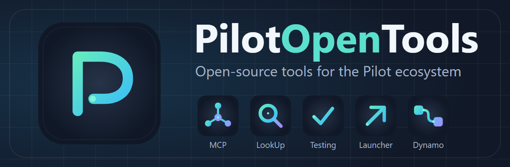

# Pilot Open Tools

Открытые инструменты для разработчиков и пользователей Pilot-ICE Enterprise и Pilot-BIM: расширения, средства тестирования, интеграции и вспомогательные утилиты.

## Проекты

| Проект | Описание |
| --- | --- |
| [PilotLookUp](https://github.com/PilotOpenTools/PilotLookUp) | Инструмент для разработчиков, позволяющий легко просматривать и изучать объекты Pilot. |
| [PilotMCP](https://github.com/PilotOpenTools/PilotMCP) | MCP-сервер для работы с Pilot. [Документация](https://pilotopentools.github.io/PilotMCP/). |
| [PilotLauncher](https://github.com/PilotOpenTools/PilotLauncher) | Лаунчер версий Pilot: скачивает версии из центра загрузок, запускает несколько версий рядом в изолированных профилях, ставит расширения. |
| [PilotTestingTools](https://github.com/PilotOpenTools/PilotTestingTools) | Тесты внутри клиента (PilotTestHost) и сквозные UI-тесты через UI Automation (PilotUITesting). |
| [DynamoPilot](https://github.com/PilotOpenTools/DynamoPilot) | Интеграция Dynamo в Pilot с набором узлов для работы с объектами Pilot. |

## Участие

Нашли ошибку или есть идея — откройте issue в соответствующем репозитории. Pull request'ы приветствуются.
